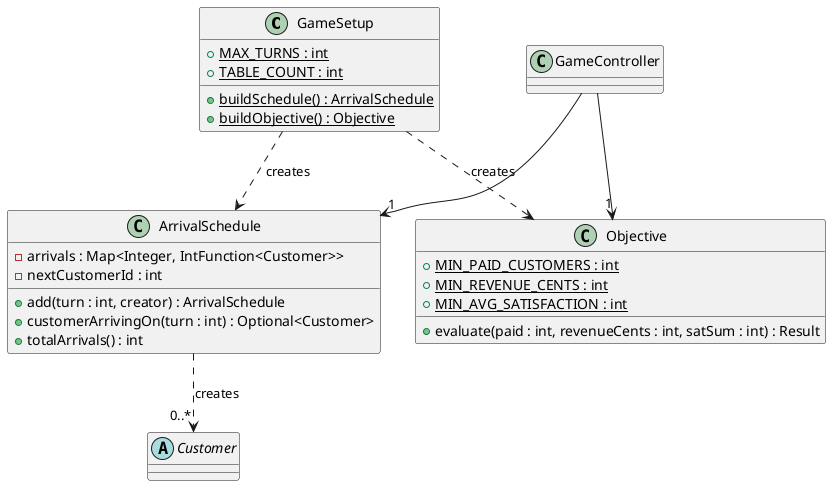
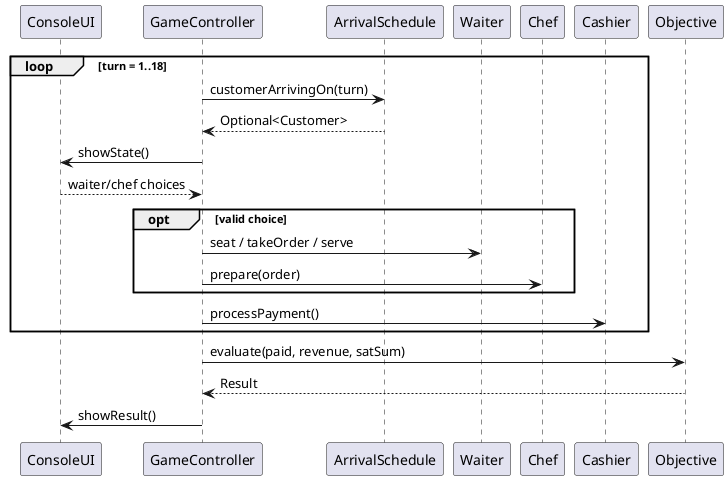

# SC2002 Restaurant Rush: Member 5 Notes (Stage 2)

Member 5 owns: **ArrivalSchedule**, **Objective**, **GameSetup** (Stages 1-2), and **HappyHour** and **PriceCalculator** (Stage 3).

## Team split

| Member | Part |
|---|---|
| 1 | GameController, six-step turn sequence, restaurant rules (seating, eating, payment, abandonment) |
| 2 | Customer, Order, Table, status enums; Stage 2 VIPCustomer and CriticCustomer; Stage 3 architecture and changes |
| 3 | Waiter, Chef, Cashier, menu classes; Stage 3 Host and ComboMeal |
| 4 | ConsoleUI, input validation and re-asking, money in integer cents, dashboard display |
| 5 (you) | ArrivalSchedule, Objective, GameSetup; Stage 3 HappyHour and PriceCalculator |

## What Stage 2 requires from your part

- **ArrivalSchedule:** the base-setting run must include at least one VIP and one Critic. You may replace two of the regular arrivals, but there must still be six arrivals, at the start of turns 1, 4, 7, 10, 13 and 16.
  - Do not put the VIP or Critic on turn 16: that customer can't finish paying within 18 turns. Turn 13 is also tight.
  - Chosen schedule: Regular on turns 1, 7, 13 and 16, VIP on turn 4, Critic on turn 10.
  - Never check customer types. Behaviour must be dispatched through the customer objects, not a chain of type checks.
- **Objective:** no logic change. The win and lose criteria are the same (at least 4 paid, revenue at least $45, average satisfaction at least 60).
- **GameSetup:** small wiring change to register VIP and Critic in the schedule.
- **PriceCalculator is Stage 3**, but the VIP 10% discount is a Stage 2 requirement. Agree with Member 2 that customer classes expose a discount (for example `getDiscountRate()`), and PriceCalculator then applies it first and Happy Hour second in Stage 3.

## What you need from other members

- **Member 2:** public constructors `RegularCustomer(int id)`, `VIPCustomer(int id)`, `CriticCustomer(int id)`.
- **Member 1:** the controller calls `schedule.customerArrivingOn(turn)` in step 1, and `objective.evaluate(paidCount, revenueCents, paidSatisfactionSum)` after turn 18.
- **Members 3 and 4:** their constructors, so `GameSetup.createGame()` can be completed.

## Steps to finish

1. Get constructor and method signatures from Members 1 and 2, and match package names.
2. Fill in `GameSetup.createGame()` once Members 1, 3 and 4 have their constructors, and add a `Main`.
3. Agree the VIP discount design with Member 2.
4. Run the full game; check VIP and Critic both reach payment; find reproducible victory and defeat runs.
5. Tag `stage-1` before merging Stage 2 changes.
6. Update the README transition table, then tag `stage-2`.
7. Start Stage 3 (HappyHour, PriceCalculator) only after the Stage 2 merge works.

## Replace in place or new files?

Edit the same files in place. Do not create `ArrivalSchedule2.java`. The `stage-1` Git tag preserves your Stage 1 versions, and the diff between tags shows what changed. Leave `Objective` untouched if your Stage 1 version already works. Only genuinely new classes (VIPCustomer, CriticCustomer) are new files. Don't paste my code over yours; if your Stage 1 design already works, keep it and change only the schedule data.

## README

Add to the Stage 1 → 2 section (adjust to what you really changed):

```
Changed files
- ArrivalSchedule.java: schedule now includes VIP (turn 4) and Critic (turn 10) arrivals, still six in total.
- GameSetup.java: wires VIPCustomer and CriticCustomer into the schedule.
Unchanged: Objective.java (win and lose rules are the same in Stage 2).
```

The README needs, per transition: new files; existing files changed or deleted with reasons; commit or compare link (`https://github.com/<user>/<repo>/compare/stage-1...stage-2`). It is a group file, so agree one owner to avoid merge conflicts. Video timestamps go in later.

## PDF report

- **Class diagram (25):** show ArrivalSchedule, Objective and GameSetup with attributes and operations with visibility, associations with multiplicities, and annotations for encapsulation, polymorphism and composition. It must match the Stage 3 code.
- **Design discussion (15):**
  - SRP: each of your classes has one job.
  - OCP: a new customer type needs only one new `add(...)` line.
  - Trade-off: an enum plus `switch` would be a type check, so creator functions were chosen.
  - Only claim principles your code really shows.
- **Functional evidence:** the schedule and why turn 16 isn't used; victory and defeat console runs with the Objective breakdown.
- **Stage comparison and reflection:** Stage 1 → 2 changed ArrivalSchedule and GameSetup only.
- **Sequence diagram (20):** your contribution is the messages `customerArrivingOn(turn)` at the start and `evaluate(...)` at the end.

## Making the diagrams in Visual Paradigm

**Class diagram:** Diagram → New → Class Diagram. Add classes with the Class tool; add attributes and operations by right-click → Add (type visibility such as `-arrivals : Map` directly). Use Association, Generalization, Composition, Aggregation and Dependency, and set multiplicities by double-clicking the line. Use Enumeration for enums and Note for annotations. Visual Paradigm can generate a class diagram from Java source as a starting point, but it must be trimmed and checked against the code.

**Sequence diagram:** Diagram → New → Sequence Diagram. Add lifelines (ConsoleUI, GameController, ArrivalSchedule, Waiter, Chef, Cashier, Objective, and so on), drag messages between them, and use Combined Fragment with `loop`, `alt` or `opt` for loops and guards. The scenario must include arrival and order, Waiter and Chef assignments, READY then SERVED, eating, payment, the result check, and one Stage 2 or 3 behaviour.

**Tips:** export as PNG or PDF at high resolution; one person holds the master `.vpp` file; draw the final diagrams after Stage 3 and compare with the code.

### Class diagram reference (PlantUML; redraw in Visual Paradigm)



### Sequence diagram skeleton (PlantUML reference)



## Code (package `restaurant`; change to match your repo)

Tested with throwaway stub customer classes (six arrivals on turns 1/4/7/10/13/16, VIP and Critic present, win/lose thresholds at exact boundaries, no crash when nobody paid). Customer constructors `(int id)` are assumed.

### ArrivalSchedule.java

```java
package restaurant;

import java.util.HashMap;
import java.util.Map;
import java.util.Optional;
import java.util.function.IntFunction;

/**
 * Decides WHO arrives WHEN. Pure data + creation; contains no game rules.
 *
 * Each entry maps a turn number to a creator (an IntFunction taking the new
 * customer's id). Because the creator is supplied by GameSetup
 * (e.g. VIPCustomer::new), this class never checks a customer's type, so
 * Stage 3 (or a new customer type) needs no change here.
 */
public class ArrivalSchedule {

    private final Map<Integer, IntFunction<? extends Customer>> arrivals = new HashMap<>();
    private int nextCustomerId = 1;

    /** Register an arrival at the start of the given turn. */
    public ArrivalSchedule add(int turn, IntFunction<? extends Customer> creator) {
        if (turn < 1) {
            throw new IllegalArgumentException("Turn must be >= 1: " + turn);
        }
        if (arrivals.containsKey(turn)) {
            throw new IllegalArgumentException("An arrival is already scheduled for turn " + turn);
        }
        arrivals.put(turn, creator);
        return this;
    }

    /**
     * Called by GameController in step 1 (Arrivals). Returns the new customer
     * for this turn, or empty if nobody arrives. Each call for a scheduled
     * turn creates a fresh customer with the next id.
     */
    public Optional<Customer> customerArrivingOn(int turn) {
        IntFunction<? extends Customer> creator = arrivals.get(turn);
        if (creator == null) {
            return Optional.empty();
        }
        return Optional.of(creator.apply(nextCustomerId++));
    }

    public boolean hasArrivalOn(int turn) {
        return arrivals.containsKey(turn);
    }

    public int totalArrivals() {
        return arrivals.size();
    }
}
```

### Objective.java

```java
package restaurant;

/**
 * Victory/defeat rule, checked once after turn 18 (no early ending).
 * Stateless: the controller passes in the final figures. Satisfaction is
 * compared with integers (sum >= 60 * count) to avoid floating-point issues.
 */
public class Objective {

    public static final int MIN_PAID_CUSTOMERS = 4;
    public static final int MIN_REVENUE_CENTS = 4500;      // $45.00
    public static final int MIN_AVG_SATISFACTION = 60;

    /** Outcome with a per-target breakdown for the final screen. */
    public static final class Result {
        private final boolean paidOk;
        private final boolean revenueOk;
        private final boolean satisfactionOk;

        private Result(boolean paidOk, boolean revenueOk, boolean satisfactionOk) {
            this.paidOk = paidOk;
            this.revenueOk = revenueOk;
            this.satisfactionOk = satisfactionOk;
        }

        public boolean isPaidCustomersMet()  { return paidOk; }
        public boolean isRevenueMet()        { return revenueOk; }
        public boolean isSatisfactionMet()   { return satisfactionOk; }
        public boolean isVictory()           { return paidOk && revenueOk && satisfactionOk; }
        public String label()                { return isVictory() ? "VICTORY" : "DEFEAT"; }
    }

    /**
     * @param paidCount             customers who paid
     * @param revenueCents          revenue in integer cents (paid orders only)
     * @param paidSatisfactionSum   sum of satisfaction recorded at payment, over paid customers
     */
    public Result evaluate(int paidCount, int revenueCents, int paidSatisfactionSum) {
        boolean paidOk = paidCount >= MIN_PAID_CUSTOMERS;
        boolean revenueOk = revenueCents >= MIN_REVENUE_CENTS;
        // paidCount == 0 can never satisfy paidOk, so no divide-by-zero concern here.
        boolean satisfactionOk = paidCount > 0
                && paidSatisfactionSum >= (long) MIN_AVG_SATISFACTION * paidCount;
        return new Result(paidOk, revenueOk, satisfactionOk);
    }

    /** Human-readable summary of each target for the final result screen. */
    public String describe(Result r, int paidCount, int revenueCents, int paidSatisfactionSum) {
        String avg = paidCount == 0 ? "N/A"
                : String.format("%.1f", paidSatisfactionSum / (double) paidCount);
        return String.format(
                "%s%n  Paid customers : %d (need >= %d) %s%n  Revenue        : $%d.%02d (need >= $%d.%02d) %s%n  Avg satisfaction: %s (need >= %d) %s",
                r.label(),
                paidCount, MIN_PAID_CUSTOMERS, mark(r.isPaidCustomersMet()),
                revenueCents / 100, revenueCents % 100, MIN_REVENUE_CENTS / 100, MIN_REVENUE_CENTS % 100,
                mark(r.isRevenueMet()),
                avg, MIN_AVG_SATISFACTION, mark(r.isSatisfactionMet()));
    }

    private static String mark(boolean ok) { return ok ? "[met]" : "[NOT met]"; }
}
```

### GameSetup.java

```java
package restaurant;

/**
 * Wiring: the one place that knows the base-setting values and which
 * concrete customer classes arrive on which turn.
 *
 * STAGE 2 change vs Stage 1: buildSchedule() now uses VIPCustomer and
 * CriticCustomer for two of the six arrivals (turns 4 and 10).
 */
public final class GameSetup {

    public static final int MAX_TURNS = 18;
    public static final int TABLE_COUNT = 2;

    private GameSetup() { }

    /** Base-setting schedule: still six arrivals on turns 1,4,7,10,13,16. */
    public static ArrivalSchedule buildSchedule() {
        return new ArrivalSchedule()
                .add(1,  RegularCustomer::new)
                .add(4,  VIPCustomer::new)        // Stage 2: replaces a Regular
                .add(7,  RegularCustomer::new)
                .add(10, CriticCustomer::new)     // Stage 2: replaces a Regular
                .add(13, RegularCustomer::new)
                .add(16, RegularCustomer::new);   // cannot finish paying by turn 18 (intended)
    }

    public static Objective buildObjective() {
        return new Objective();
    }

    /*
     * TODO once teammates' constructors are known, add something like:
     *
     * public static GameController createGame() {
     *     Menu menu = new Menu();                       // Member 3
     *     Restaurant restaurant = new Restaurant(TABLE_COUNT, menu);   // Member 1/2
     *     Waiter waiter = new Waiter(restaurant);       // Member 3
     *     Chef chef = new Chef(restaurant);
     *     Cashier cashier = new Cashier(restaurant);
     *     ConsoleUI ui = new ConsoleUI();               // Member 4
     *     return new GameController(restaurant, waiter, chef, cashier,
     *                               buildSchedule(), buildObjective(), ui, MAX_TURNS);
     * }
     * and Main: GameSetup.createGame().run();
     */
}
```
